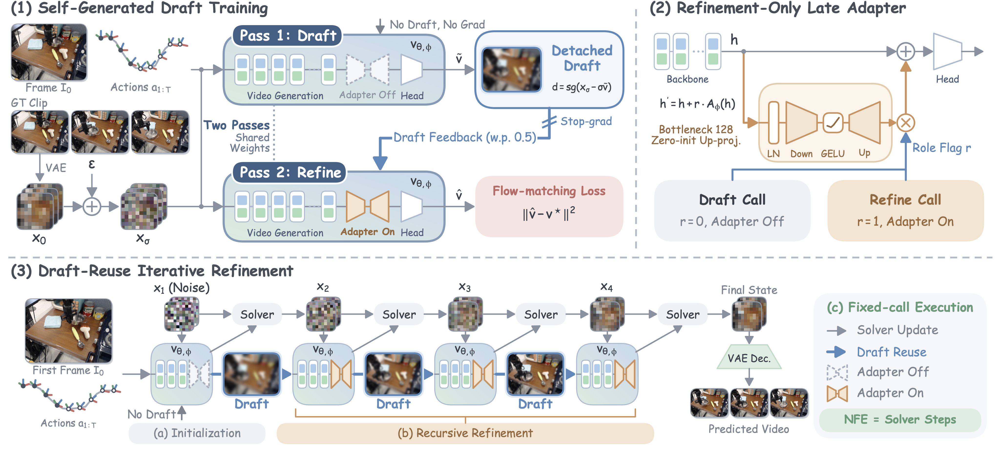
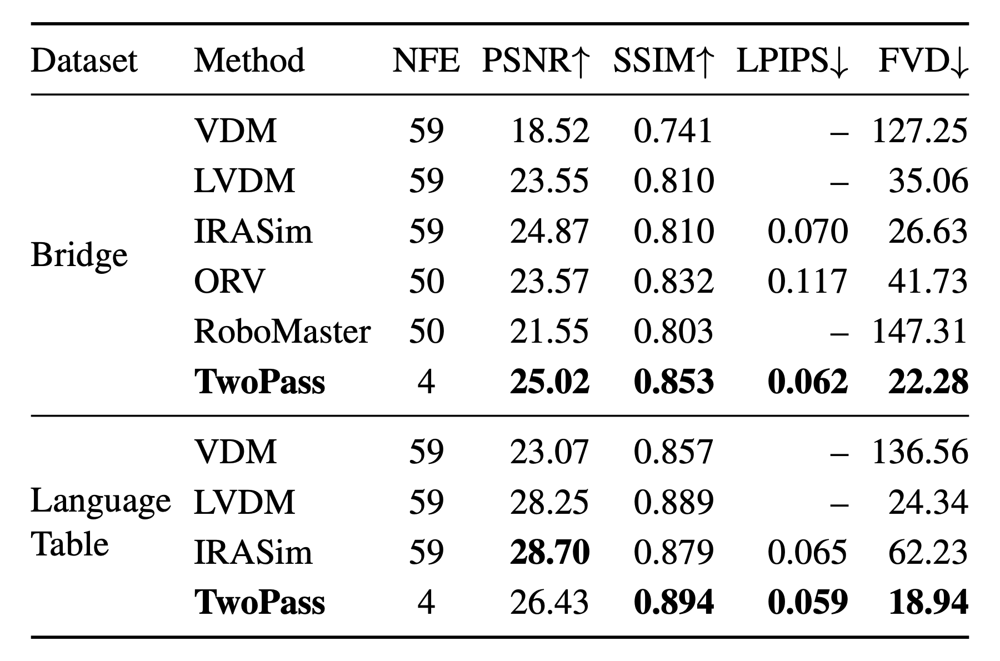
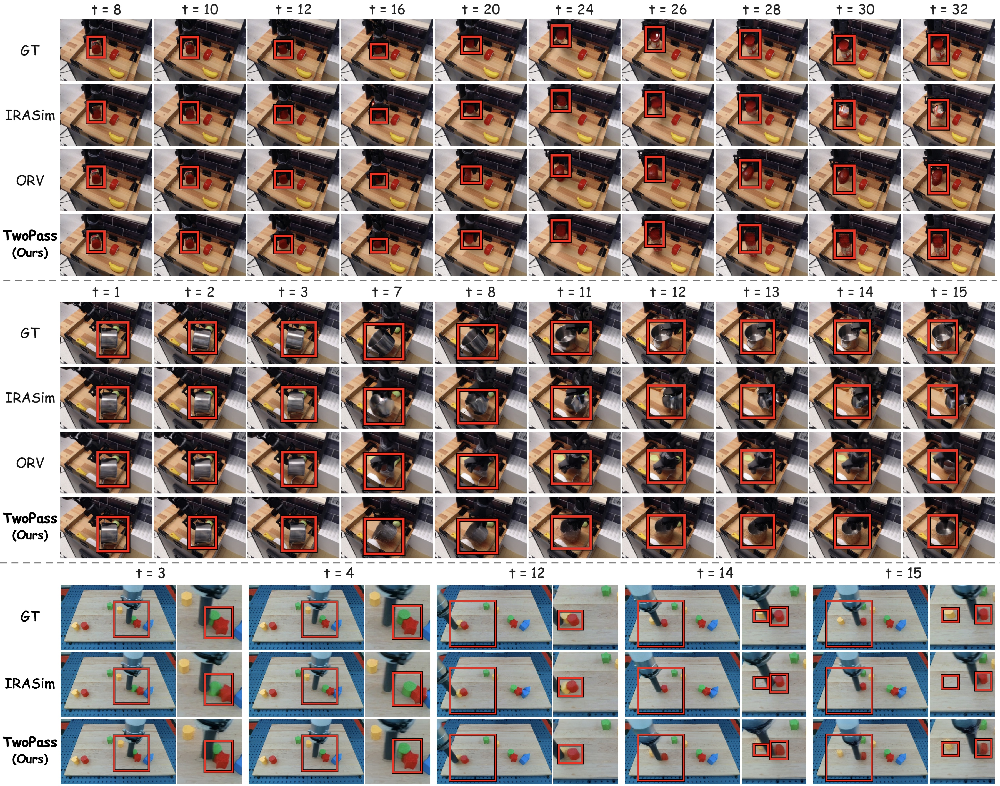

# TwoPass: Draft-Guided Few-Step Video Prediction for Robotic Manipulation

<p align="center">
  <a href="https://arxiv.org/abs/2611.25553"></a>
  <a href="https://huggingface.co/Junjun2333/TwoPass"></a>
  <a href="#citation"></a>
  <br>
  <a href="#installation">Install</a> ·
  <a href="#download-weights-and-data">Download weights and data</a> ·
  <a href="#1-data-preparation">Prepare data</a> ·
  <a href="#2-training">Train</a> ·
  <a href="#3-evaluation">Evaluate</a> ·
  <a href="#results">Results</a>
</p>

<p align="center"></p>

TwoPass is an action-conditioned video prediction model for robotic
manipulation, fine-tuned from Wan2.2-TI2V-5B: given one observed frame and the
future robot actions, it predicts the following frames in as few as four network
calls. **Self-Generated Draft Training** teaches the model to refine its own
draft prediction, a **Refinement-Only Late Adapter** gives draft-conditioned
calls a dedicated correction pathway, and **Draft-Reuse Iterative Refinement**
reuses every clean estimate as the next draft at inference, so each solver step
costs one network call.

## Installation

```bash
pip install -r requirements.txt    # Python 3.10, PyTorch 2.8
```

## Download weights and data

- **Pretrained weights**, [Wan2.2-TI2V-5B](https://github.com/Wan-Video/Wan2.2):
  ```bash
  pip install -U huggingface_hub
  hf download Wan-AI/Wan2.2-TI2V-5B --local-dir ./Wan2.2-TI2V-5B
  ```
- **Datasets**, Bridge and Language Table as released by
  [IRASim](https://github.com/bytedance/IRASim):
  [bridge_train_data.tar.gz](https://lf-robot-opensource.bytetos.com/obj/lab-robot-public/opensource_IRASim_v1/bridge_train_data.tar.gz) and
  [languagetable_train_data.tar.gz](https://lf-robot-opensource.bytetos.com/obj/lab-robot-public/opensource_IRASim_v1/languagetable_train_data.tar.gz)
  (also on [Hugging Face](https://huggingface.co/datasets/fangqi/IRASim)). The
  archives hold the training and test splits and extract to
  `opensource_robotdata/{bridge,languagetable}`; such a dataset directory is
  `DATA_ROOT` below.
- **I3D detector for FVD**, `i3d_torchscript.pt` of
  [StyleGAN-V](https://github.com/universome/stylegan-v):
  <https://www.dropbox.com/s/ge9e5ujwgetktms/i3d_torchscript.pt?dl=1>
- **TwoPass checkpoints** on [Hugging Face](https://huggingface.co/Junjun2333/TwoPass):
  [Bridge](https://huggingface.co/Junjun2333/TwoPass/blob/main/bridge/twopass_bridge.pt) ·
  [Language Table](https://huggingface.co/Junjun2333/TwoPass/blob/main/languagetable/twopass_languagetable.pt)
  ```bash
  hf download Junjun2333/TwoPass --local-dir ./checkpoints
  ```
  Pass `./checkpoints/bridge/twopass_bridge.pt` (or
  `./checkpoints/languagetable/twopass_languagetable.pt`) as `--checkpoint` in
  [Evaluation](#3-evaluation) to reproduce the results without training.

## Usage

Commands are shown for Bridge; use `configs/languagetable.json` and the Language
Table `DATA_ROOT` for the other dataset.

### 1. Data preparation

Select the training windows, then encode them
with the Wan2.2 VAE and text encoder (one GPU, or several with
`--shard i --nshards n`):

```bash
python -m twopass.select_windows --config configs/bridge.json \
    --data_root $DATA_ROOT --out_dir /path/to/train_data/bridge
python -m twopass.cache_windows --config configs/bridge.json \
    --manifest /path/to/train_data/bridge/train_manifest.json --wan_dir ./Wan2.2-TI2V-5B
```

### 2. Training

The configs follow the schedule of the paper, 300k iterations at an
equivalent batch size of eight:

```bash
export WAN_DIR=/path/to/Wan2.2-TI2V-5B
MANIFEST=/path/to/train_data/bridge/train_manifest.json OUT_DIR=/path/to/runs/bridge \
    bash scripts/train.sh configs/bridge.json
MANIFEST=/path/to/train_data/languagetable/train_manifest.json OUT_DIR=/path/to/runs/languagetable \
    bash scripts/train.sh configs/languagetable.json
```

Add `--resume_checkpoint $OUT_DIR/stepXXXXXXX.pt` to continue a run.

### 3. Evaluation

Generate and score the test set with 4 (or 6) network calls per
clip, then report PSNR / SSIM / LPIPS / FVD (`--shard i --nshards n` splits the
generation over GPUs):

```bash
python -m twopass.evaluate --config configs/bridge.json --nfe 4 \
    --checkpoint /path/to/runs/bridge/step0300000.pt --wan_dir $WAN_DIR \
    --data_root $DATA_ROOT --i3d_path /path/to/i3d_torchscript.pt --out_dir /path/to/eval/bridge
python -m twopass.aggregate --config configs/bridge.json \
    --data_root $DATA_ROOT --eval_dir /path/to/eval/bridge
```

## Results

<p align="center"></p>

<p align="center"></p>

## Citation

If you find TwoPass useful, please cite [our paper](https://arxiv.org/abs/2611.25553):

```bibtex
@article{liu2026twopass,
  title         = {TwoPass: Draft-Guided Few-Step Video Prediction for Robotic Manipulation},
  author        = {Liu, Yijun and Ge, Shijia and Feng, Tongtong and Wang, Xin and Meng, Yuan and Liu, Yuwei and Wang, Zhi and Zhu, Wenwu},
  journal       = {arXiv preprint arXiv:2611.25553},
  year          = {2026},
  eprint        = {2611.25553},
  archivePrefix = {arXiv},
  primaryClass  = {cs.CV},
  url           = {https://arxiv.org/abs/2611.25553}
}
```

## License and acknowledgements

Released under the Apache License 2.0. The files in `wan/` come from
[Wan2.2](https://github.com/Wan-Video/Wan2.2) (Apache License 2.0, see `NOTICE`).
The datasets are provided by IRASim, FVD uses the I3D detector of StyleGAN-V,
and LPIPS uses the `lpips` package.
